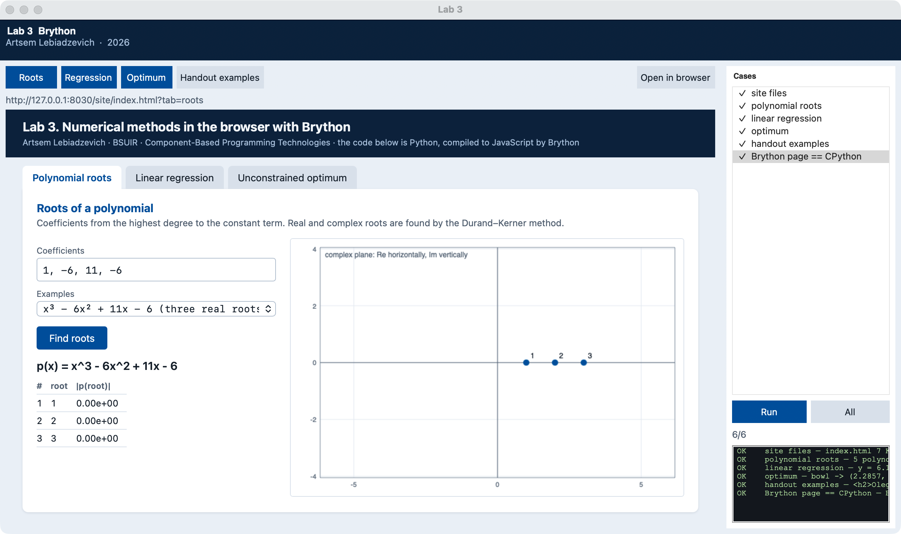

# Lab 3 report

**Institution**  
Belarusian State University of Informatics and Radioelectronics

Faculty of Computer Systems and Networks (FCSN), POIT, group PI

**Lab 3 report**  
Course: Component-Based Programming Technologies

**Topic:** client site in Python with Brython: polynomial roots, linear-regression forecast, optimum of a function

| | |
| --- | --- |
| Author | Artsem Lebiadzevich, year-2 MSc, FCSN, POIT, PI |
| Supervisor | Oleg German, PhD, Associate Professor |
| Minsk | 2026 |

---

## 1. Goal

Study Brython, the framework that runs Python scripts in a web page, and use it to write a client site that finds the roots of a polynomial, makes a forecast with linear regression and finds the optimum of a function without restrictions.

## 2. Work done

1. Brython 3.15.0 installed with `pip install brython` (the handout uses 3.9); `brython.js` and `brython_stdlib.js` are served locally, not from the CDN (`scripts/fetch_runtimes.py`).
2. Handout examples in [`lab3/site/examples.html`](../lab3/site/examples.html): a heading from `browser.html.H2`, an input with three buttons (alert, greeting, square), the trapezoidal integral of `x**2`.
3. Numerical methods in [`lab3/numerics.py`](../lab3/numerics.py), pure Python (`math`, `cmath` only):
   - roots: Durand–Kerner for all complex roots, Newton polishing, closed forms for degrees 1–2, zero roots from trailing zeros;
   - regression: least squares line, R², RMSE, forecast of the next steps with a 95 % band;
   - optimum: Nelder–Mead, gradient descent with a line search, golden section; maximum by minimizing `-f`; the function is typed as text (`^` is power) and compiled once into a lambda that sees only `math` names.
4. Site [`lab3/site/index.html`](../lab3/site/index.html) + [`app.py`](../lab3/site/app.py): three tabs, input fields, result tables built with `browser.html`, plots on a `<canvas>` (complex plane, scatter + line + band, heat map with the search path).
5. `lab3/server.py` serves `lab3/` so that `/numerics.py` is the same file the tests import (`pythonpath: ['/']`).
6. Window (`python main.py --lab 3 --gui`): the site in a web view next to a list of checks; CLI (`--lab 3`) and unit tests.

Code: [`lab3/`](../lab3/). Theory: [`labs_info/lab3_theory.md`](../labs_info/lab3_theory.md). Handout: `Lab_Brython/Lab__Brython.docx`.



## 3. Differences from the handout

The handout was written for Brython 3.9; three things behave differently in 3.15:

- `import browser` does not give `browser.html` any more; `import browser.html` is needed.
- Brython caches the standard library in IndexedDB. A headless browser that dumps the DOM right after `load` sees an unfinished page; `brython({indexedDB: false})` fixes it.
- `"%g" % x` is wrong for tiny and huge numbers (`2.2e-16` becomes `0e+00`), `"{:g}".format(x)` is right, so the site formats numbers with `str.format`.

## 4. Results

`python main.py --lab 3` prints:

```
x^3 - 6x^2 + 11x - 6 -> 1, 2, 3
x^2 + 1 -> -i, i
x^4 - 1 -> -1, -i, i, 1
polynomial_roots -> 5 polynomials, max |p(root)| = 8.9e-16; x^2+1 -> ±i
regression -> y = 6.1394x + 95.333, R² = 0.9951, x=11 -> 162.87
optimum -> bowl -> (2.2857, -2.5714), Rosenbrock -> (1.0000, 1.0000) in 126 steps, max of sin·exp at x = 1.4711
brython_page -> Brython 3.15.0 in headless browser: 26 values equal CPython's
```

The last line is the main check: headless Chrome opens `index.html?autorun=1`, Brython compiles `app.py` in the browser, and the page writes everything it computed (roots, regression, six optimizations) as JSON into the DOM; the test compares these 26 values with CPython's.

| Task | Input | Result |
| --- | --- | --- |
| roots | `1, -6, 11, -6` | 1, 2, 3 |
| roots | `1, 0, 1` | −i, i |
| regression | 10 points, forecast 4 steps | y = 6.139·x + 95.33, R² = 0.995; x = 11…14 → 162.9, 169.0, 175.1, 181.3 |
| optimum | `(x-1)^2 + 2*(y+2)^2 + x*y` | minimum at (2.2857, −2.5714) = (16/7, −18/7), f = −3.5714 |
| optimum | Rosenbrock from (−1.2, 1) | Nelder–Mead reaches (1, 1) in 126 steps; gradient descent needs 20 000 and stops at the limit |
| optimum | `x^4 - 3*x^2 + x` | gradient descent from 2 and golden section on [−0.5, 2] find the local minimum x ≈ 1.131 |
| optimum | `sin(x)*exp(-0.1*x)`, maximum | x = 1.4711 = arctan 10 |

Screenshots: [regression](screenshots/lab3_regression.png), [optimum](screenshots/lab3_optimum.png), [handout examples](screenshots/lab3_examples.png).

## 5. Conclusions

Brython turns a page into a Python application: handlers, DOM access and the canvas are written in Python, and a plain module such as `numerics.py` is shared between the browser and ordinary Python, so it can be tested on a server and then run on a client unchanged. The limits are also visible: no numpy (the methods are pure Python), a startup cost for the 5 MB library, and small differences between versions of the framework.

## 6. Control questions

1. **How to implement a client site with Brython?**  
   Load `brython.js` and `brython_stdlib.js`, call `brython()` from `<body onload>`, write Python in `<script type="text/python">` (inline or `src="app.py"`), take elements with `document["id"]`, attach handlers with `bind("click", f)` and show results with `.text` or `document <= html.TAG(...)`.

2. **How to include Python libraries in a Brython script?**  
   Standard modules are `import`ed as usual: they come from `brython_stdlib.js`. Your own modules are `.py` files on the server; Brython fetches them when they are imported and `pythonpath` says where to look (`brython({pythonpath: ['/']})`). Compiled packages such as numpy are not available.

3. **Explain the solution of the laboratory work.**  
   `numerics.py` holds the three methods; `app.py` reads the fields, calls them and draws; `index.html` is the markup. The server gives the browser the same `numerics.py` that the tests use, and a test checks that the browser's numbers equal CPython's.

## 7. Demo checklist

- Roots tab: pick `x⁴ − 1` in the examples, two real and two complex roots on the plane;
- Regression tab: change a point, press Build forecast, the band widens away from the data;
- Optimum tab: Rosenbrock with Nelder–Mead, then gradient descent (slow in the valley);
- Handout examples page: square, greeting, integral.
