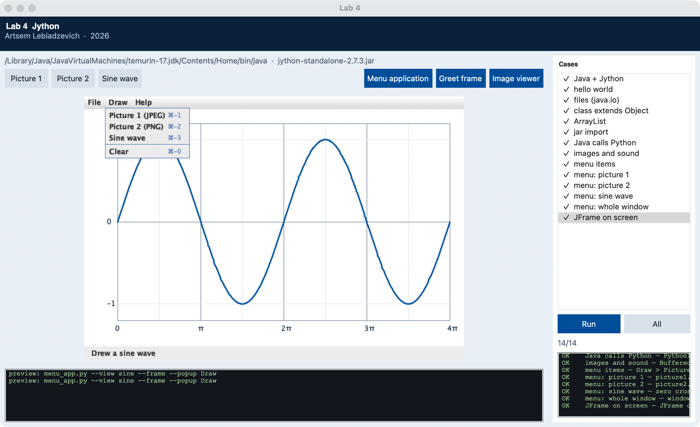

# Lab 4 report

**Institution**  
Belarusian State University of Informatics and Radioelectronics

Faculty of Computer Systems and Networks (FCSN), POIT, group PI

**Lab 4 report**  
Course: Component-Based Programming Technologies

**Topic:** Jython: interaction of Java and Python, Swing menu application

| | |
| --- | --- |
| Author | Artsem Lebiadzevich, year-2 MSc, FCSN, POIT, PI |
| Supervisor | Oleg German, PhD, Associate Professor |
| Minsk | 2026 |

---

## 1. Goal

Study the interaction of Java and Python with Jython and write an application whose JFrame menu loads two different pictures and draws a sine wave on a canvas.

## 2. Work done

1. Jython 2.7.3 (`jython-standalone-2.7.3.jar`, SHA-1 checked against Maven Central) and Temurin JDK 17; scripts run as `java -jar jython-standalone-2.7.3.jar script.py`.
2. All handout examples in [`lab4/jython/`](../lab4/jython/): Java version and time, `Hello, world!`, files with `java.io`, `class MyClass(Object)`, the `JFrame` with Greet/Clear, the JPEG viewer.
3. Examples of the lecture: `ArrayList`, a Java class from a jar (`sys.path.append`), drawing into a `BufferedImage`, and the reverse direction: `JythonHelloWorld.java` runs Python through `PythonInterpreter`.
4. The task, [`menu_app.py`](../lab4/jython/menu_app.py): `JFrame` with the menu **File / Draw / Help**; Draw has *Picture 1* (JPEG), *Picture 2* (PNG), *Sine wave*, *Clear* with `⌘1…⌘0` shortcuts. `Canvas(JPanel)` overrides `paintComponent`; one `Controller(ActionListener)` handles all items. Two pictures are generated by `scripts/make_assets.py` into `assets/lab4/`.
5. Menu bar, canvas and status line live in a `JRootPane`, so `--snapshot` can draw them into a PNG without a display and the tests can look at pixels.
6. [`lab4/runtime.py`](../lab4/runtime.py) finds Java and the jar and runs scripts; [`lab4/cases.py`](../lab4/cases.py) are the checks; window `python main.py --lab 4 --gui`.

Code: [`lab4/`](../lab4/). Theory: [`labs_info/lab4_theory.md`](../labs_info/lab4_theory.md). Handout: `Lab_Jython/Lab_Jython.docx`.



## 3. Differences from the handout

The handout assumes Java 8; with JDK 17:

- `import javax.swing as swing` and `import java.awt as awt` fail with *No module named …*, while `from javax.swing import JFrame` works. `jcompat.py` calls `sys.add_package` for the Swing packages, after which the handout's imports work.
- A protected method of the Java superclass is called as `self.super__paintComponent(g)`.
- Jython is Python 2.7: `from __future__ import print_function`, `u""` literals for `π`, `-Dfile.encoding=UTF-8`.
- A `JFrame` does not exist in headless mode, so automatic checks use `JPanel`/`JRootPane`; the `JFrame` of the handout is checked in one case that needs a screen.

## 4. Results

`python main.py --lab 4` prints:

```
environment -> Java 17.0.17 + Jython 2.7.3 (jython-standalone-2.7.3.jar)
files -> java.io.File and FileWriter created example_file.txt (24 bytes)
python_class_extends_java -> class MyClass(Object): a Python class is a Java object
jar_import -> sys.path.append(myclass.jar); from com import MyClass -> Hello, dear oleg
java_calls_python -> PythonInterpreter inside Java: exec, import of jy10, set/get of values
menu_picture1 -> picture1.jpg drawn at 564x376, mean error 0.6/255
menu_picture2 -> picture2.png drawn at 564x376, mean error 0.4/255
menu_sine -> zero crossings at 197, 336, 476 px, crest at 124 px, amplitude 0.84 of the half-height
swing_window -> JFrame opened, Greet printed the name, Clear emptied the field
```

The window checks work on the pixels: a picture case compares the canvas with the source file scaled to the same box, the sine case finds the curve in every column and requires zero crossings at π, 2π, 3π (±3 px), the first crest at π/2 and the amplitude 1/1.2 of the half-height.

| View | Picture |
| --- | --- |
| Picture 1 (JPEG) | [lab4_picture1.png](screenshots/lab4_picture1.png) |
| Picture 2 (PNG) | [lab4_picture2.png](screenshots/lab4_picture2.png) |
| Sine wave | [lab4_sine.png](screenshots/lab4_sine.png) |
| Draw menu open | [lab4_menu.png](screenshots/lab4_menu.png) |

## 5. Conclusions

Jython makes Java classes ordinary Python names: a Python class can extend `Object`, `JPanel` or `Thread`, a jar is added with `sys.path`, and the reverse direction is a library call to `PythonInterpreter`. The price is Python 2.7 and a dependence on the JDK version: the handout's imports needed a workaround on JDK 17. Keeping the drawing in a `JPanel` and the menu in a `JRootPane` made the GUI part testable without a screen.

## 6. Control questions

1. **What is Jython and how is it run?**  
   Python 2.7 for the JVM. `java -jar jython-standalone-2.7.3.jar script.py`, or an installed `jython` launcher.

2. **How are Java classes used in a Jython program?**  
   `from java.io import File`, then `File("x")`; Java methods, fields, exceptions (`except IOException`) and inheritance (`class MyClass(Object)`) work as in Python.

3. **How to use classes from a jar file?**  
   `sys.path.append("x.jar")` or `-classpath`; then `from com import MyClass`.

4. **How to call Python from Java?**  
   Put the Jython jar on the classpath and use `PythonInterpreter`: `exec("...")`, `set(name, value)`, `get(name, Class)`.

5. **Explain the solution of the laboratory work.**  
   `Canvas.paintComponent` draws the current picture or the sine curve with `Graphics2D`; the menu items share one `ActionListener` that switches the canvas by the action command; a snapshot mode and tests make the result checkable.

## 7. Demo checklist

- `python main.py --lab 4 --gui`: Menu application, Draw > Picture 1, Picture 2, Sine wave, Clear;
- Greet frame: type a name, Greet prints `Hello, <name>!` to the console;
- Image viewer: the JPEG in a window;
- All cases: 14/14.
