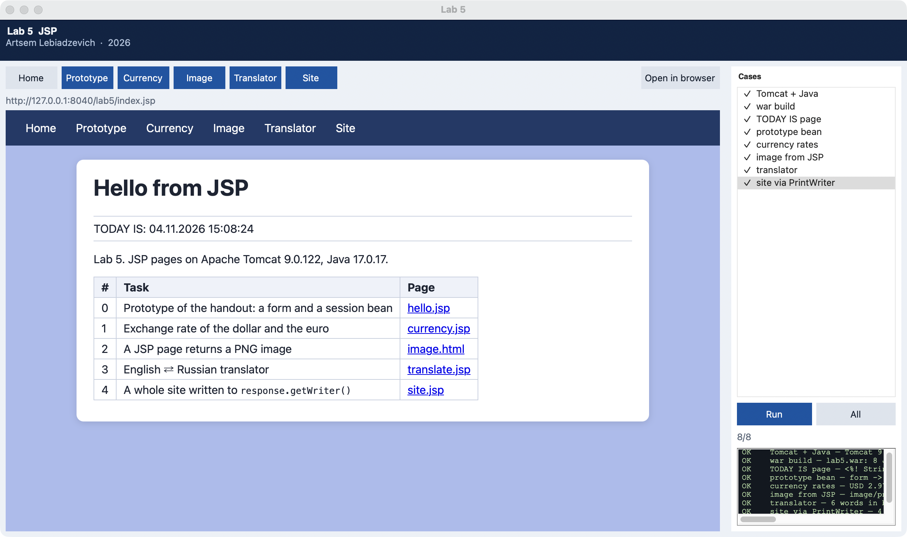

# Lab 5 report

**Institution**  
Belarusian State University of Informatics and Radioelectronics

Faculty of Computer Systems and Networks (FCSN), POIT, group PI

**Lab 5 report**  
Course: Component-Based Programming Technologies

**Topic:** JSP: Java Server Pages on Apache Tomcat

| | |
| --- | --- |
| Author | Artsem Lebiadzevich, year-2 MSc, FCSN, POIT, PI |
| Supervisor | Oleg German, PhD, Associate Professor |
| Minsk | 2026 |

---

## 1. Goal

Study JSP pages and JavaBeans on Tomcat and write four applications: exchange rates of the dollar and the euro, a picture generated by a JSP page, an English ⇄ Russian translator, and a site returned through `response.getWriter()`.

## 2. Work done

1. Tomcat 9.0.122 (SHA-512 checked) and Temurin JDK 17. [`lab5/runtime.py`](../lab5/runtime.py) compiles the beans with `javac --release 8`, packs `lab5.war` with `jar`, writes its own `CATALINA_BASE` (port 8040) and starts `org.apache.catalina.startup.Bootstrap`.
2. The handout's examples: `index.jsp` with `<%! String getDate() %>` and `TODAY IS:`, the prototype `hello.jsp` → `response.jsp` with the session bean `com.Hello`.
3. Task 1, `currency.jsp` → `rate.jsp` + `com.CurrencyBean`: the name is typed like the name in the prototype (`dollar`, `USD`, `доллар`, `euro`, `евро`…); the rate comes from the National Bank API once a day, or from a built-in table without the network.
4. Task 2, `image.html` + `ImageServlet.jsp`: `contentType="image/png"`, a `BufferedImage` drawn with `Graphics2D` (background, sine wave, sun, text from the request) and written by `ImageIO.write`.
5. Task 3, `translate.jsp` + `com.Dictionary`: 38 word pairs, the direction is chosen by the alphabet of the word.
6. Task 4, `site.jsp`: no HTML template; four pages, the menu, styles and footer are written by `ot.println`.
7. [`lab5/cases.py`](../lab5/cases.py) are the checks over HTTP; window `python main.py --lab 5 --gui`; `python -m lab5.server` keeps Tomcat running.

Code: [`lab5/`](../lab5/). Theory: [`labs_info/lab5_theory.md`](../labs_info/lab5_theory.md). Handout: `task8/Лаб6_JSP/Условие.pdf`, `task8/Лабор_JSP.docx`.



## 3. Differences from the handout

- The handout's Tomcat 8.5.5 starts on JDK 17, but its ecj 4.5.1 cannot read some JDK 17 classes: `index.jsp` fails with `ClassFormatException` on `java.lang.System`. 8.5.100 (ecj 4.6.3) fails too; Tomcat 9 keeps `javax.servlet` and has ecj 4.20.
- `OutputStream out` of the handout's `ImageServlet.jsp` clashes with the implicit `out` (`JspWriter`); the stream is `os`, and `trimDirectiveWhitespaces="true"` keeps text out of a binary response.
- Instead of NetBeans the war is built by `javac` and `jar -cf`, as in the Tomcat lecture.

## 4. Results

`python main.py --lab 5` prints:

```
environment -> Tomcat 9.0.122 on Java 17.0.17 at http://127.0.0.1:8040/lab5/ (apache-tomcat-9.0.122)
war_build -> lab5.war: 8 JSP pages, 3 beans in WEB-INF/classes (14 KiB)
today_page -> <%! String getDate() %> + <%= getDate() %> -> TODAY IS: 04.11.2026 15:08:47
hello_prototype -> form -> response.jsp?name=Oleg -> Hello, Oleg!; the session bean keeps the name
currency_rates -> USD 2.9779, EUR 3.3323 BYN (NBRB, 2026-11-04); 6 spellings, session bean, unknown 'yen' refused
image_png -> image/png 400x240, 6090 bytes: blue background, yellow sun, 574 white text pixels
translator -> 6 words in both directions, case and spaces ignored; lexicon of 38 words
site_writer -> 4 pages written by PrintWriter ot = response.getWriter(), 5 labs in the table
```

| Page | Picture |
| --- | --- |
| Rate of the euro | [lab5_currency.png](screenshots/lab5_currency.png) |
| Image from JSP | [lab5_image.png](screenshots/lab5_image.png) |
| Translator | [lab5_translator.png](screenshots/lab5_translator.png) |
| Site via PrintWriter | [lab5_site.png](screenshots/lab5_site.png) |

## 5. Conclusions

A JSP page is a servlet written as HTML: Jasper turns it into Java and compiles it on the first request, so the page and the server must agree on the Java version — the handout's Tomcat did not. Beans keep the logic out of the page and live in a scope (`session` kept the name and the currency between requests). The same page can return any content type: HTML, a PNG from `ImageIO`, or a site written by hand to the writer.

## 6. Control questions

1. **What is JSP and how does it run?**  
   An HTML page with Java inserts. On the first request Tomcat (Jasper) generates a servlet from it, compiles it and calls `_jspService` for every request.

2. **What JSP tags are there?**  
   `<%-- --%>` comment, `<%@ %>` directive (`page import`, `include`), `<%! %>` declaration, `<% %>` scriptlet, `<%= %>` expression, and actions `jsp:useBean`, `jsp:setProperty`, `jsp:getProperty`.

3. **What is a JavaBean and how does a JSP use it?**  
   A class with a no-argument constructor and `get`/`set` properties. `jsp:useBean` creates or finds it in a scope, `jsp:setProperty property="name"` calls `setName` with the request parameter `name`, `jsp:getProperty` prints `getName()`.

4. **How does a JSP return a picture?**  
   `contentType="image/png"`, draw into a `BufferedImage`, write it with `ImageIO.write` to `response.getOutputStream()`; the HTML page refers to it with ``.

5. **How is a web application deployed to Tomcat?**  
   Pack it into a war (`jar -cvf app.war ...`) with `WEB-INF/web.xml` and `WEB-INF/classes`, put it into `webapps/`; Tomcat unpacks it and serves it at `/app/`.
