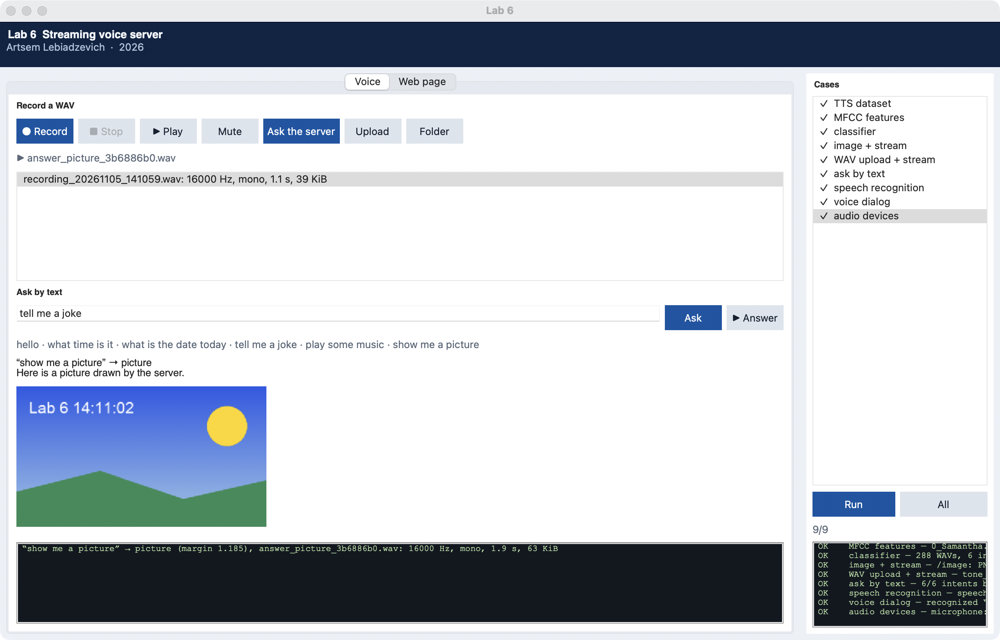

# Lab 6 report

**Institution**  
Belarusian State University of Informatics and Radioelectronics

Faculty of Computer Systems and Networks (FCSN), POIT, group PI

**Lab 6 report**  
Course: Component-Based Programming Technologies

**Topic:** Streaming web servers and a voice request to the server

| | |
| --- | --- |
| Author | Artsem Lebiadzevich, year-2 MSc, FCSN, POIT, PI |
| Supervisor | Oleg German, PhD, Associate Professor |
| Minsk | 2026 |

---

## 1. Goal

Study streaming of images and sound from a Python web server, recording and playing WAV files, text to speech and speech to text, MFCC features and a WAV classifier. Build the loop of the handout: the client records a spoken request, recognizes it and sends the text; the server speaks the text into a WAV, classifies it, and answers with a WAV that the client plays.

## 2. Work done

1. [`lab6/voice.py`](../lab6/voice.py): `Recorder` (microphone → WAV via `sounddevice`), `play` (WAV → speakers in 1024-frame chunks, as the handout's PyAudio program), `text_to_wav` (`say` on macOS, pyttsx3 elsewhere), `recognize` (Google Web Speech via `speech_recognition`).
2. [`lab6/classifier.py`](../lab6/classifier.py): 6 intents × 6 phrasings × 8 `say` voices = 288 training WAVs; 78 features from MFCC (mean, spread, mean change, and the mean of each third of the phrase); `StandardScaler` + RBF `SVC`, saved to `artifacts/lab6/model.pkl`.
3. [`lab6/server.py`](../lab6/server.py) on `http.server`, port 8050: `/image` (PNG), `/stream-image` (`multipart/x-mixed-replace` clock frames), `/audio/<file>` (WAV in 16 KiB chunks with `Range`), `/upload`, `/recordings`, `/ask` (text → WAV → intent → answer WAV), `/ask-wav` (the recording itself, when recognition is offline).
4. [`lab6/page.html`](../lab6/page.html): ask by text with `<audio>` for the answer, WAV recording in the browser (`getUserMedia` → PCM WAV in JavaScript → `/upload`), recordings list, live image stream.
5. [`lab6/client.py`](../lab6/client.py): `python -m lab6.client` records 4 s, plays the recording, recognizes it, asks the server and plays the answer.
6. Window `python main.py --lab 6 --gui`: Record / Stop / Play / Ask the server / Upload, ask by text, the answer with its picture, the web page in a tab, 9 cases.

Code: [`lab6/`](../lab6/). Theory: [`labs_info/lab6_theory.md`](../labs_info/lab6_theory.md). Handout: `lab6/ЛЕК_ЛАБ_WEB-STREAMFF2 (1).docx`.



## 3. Differences from the handout

- `sounddevice` instead of PyAudio: the same PortAudio, but a wheel without a build.
- pyttsx3 does not write WAV on macOS, so `say --data-format=LEI16@16000` is used there.
- `adjust_for_ambient_noise` eats one second by default, the whole of a short request; it is 0.2 s here.
- The handout's classifier was scored on its own five training files. Here accuracy is measured on voices and phrasings left out of training:

| Model | Unseen voice | Unseen phrasing |
| --- | --- | --- |
| handout: mean MFCC, linear SVC | 43% | 40% |
| 78 features, linear SVC | 55% | 43% |
| 78 features, RBF SVC | 60% | 53% |

Chance is 17%. The server speaks with one voice, so only the phrasing varies: training phrasings are always recognized, a new phrasing about half the time.

## 4. Results

`python main.py --lab 6` prints:

```
tts_dataset -> 288 WAVs = 6 intents x 6 phrasings x 8 voices, 0.4-2.1 s
mfcc_features -> 0_Samantha.wav: MFCC 17 frames x 13, feature vector of 78
classifier_accuracy -> 288 WAVs, 6 intents, 8 voices; accuracy: train 100%, unseen voice 60%, unseen phrasing 53%
image_endpoints -> /image: PNG 480x270; /stream-image: 3 JPEG frames in multipart/x-mixed-replace
wav_upload_and_stream -> tone_440.wav: 16000 Hz, mono, 1.0 s, 31 KiB; same bytes back; Range 0-43 -> 206 with the RIFF header; listed in /recordings
ask_by_text -> 6/6 intents by their first phrasing; time -> "It is 14:12." + answer WAV
speech_recognition -> speech.wav -> "tell me a joke"
voice_dialog -> recognized "play some music" -> music -> answer_music_8cf0bc8b.wav: 16000 Hz, mono, 3.8 s, 117 KiB
audio_devices -> microphone: MacBook Pro Microphone; speakers: MacBook Pro Speakers
```

| View | Picture |
| --- | --- |
| Window: recording asked by voice, picture answer | [lab6.png](screenshots/lab6.png) |
| Server page: music answer, recording, image stream | [lab6_web.png](screenshots/lab6_web.png) |

The window shot uses a recording voiced by `say -v Daniel` in place of the microphone.

## 5. Conclusions

A web server streams by writing the body in parts: image frames with `multipart/x-mixed-replace`, sound in chunks with `Range`, without which WebKit does not play `<audio>`. The voice loop of the handout works end to end. The classifier is the weak link: averaged MFCC loses the order of sounds, so a phrasing it has not heard is recognized about half the time, while the phrasings of the training set always are.

## 6. Control questions

1. **How does a Python web server return a picture or sound?**  
   Status 200, `Content-Type` (`image/png`, `audio/wav`), then the bytes into `wfile`; the page shows them with `` or `<audio>`.

2. **What makes a response streaming?**  
   The body is sent in parts as it is read or generated: `multipart/x-mixed-replace` for images, chunks and `Range` requests for sound.

3. **How is a WAV recorded and played in Python?**  
   A PortAudio input stream (`sounddevice` or PyAudio) gives blocks of samples that `wave` writes to a file; to play, the file is read in blocks and written to an output stream.

4. **What are MFCC?**  
   Mel-frequency cepstral coefficients: the spectrum of a window through a mel filter bank, logarithm, DCT. They describe the spectral envelope and serve as speech features.

5. **How is a WAV classifier built?**  
   Label WAV files, compute a feature vector per file (MFCC statistics), train a classifier (`SVC`) and measure accuracy on files left out of training.
